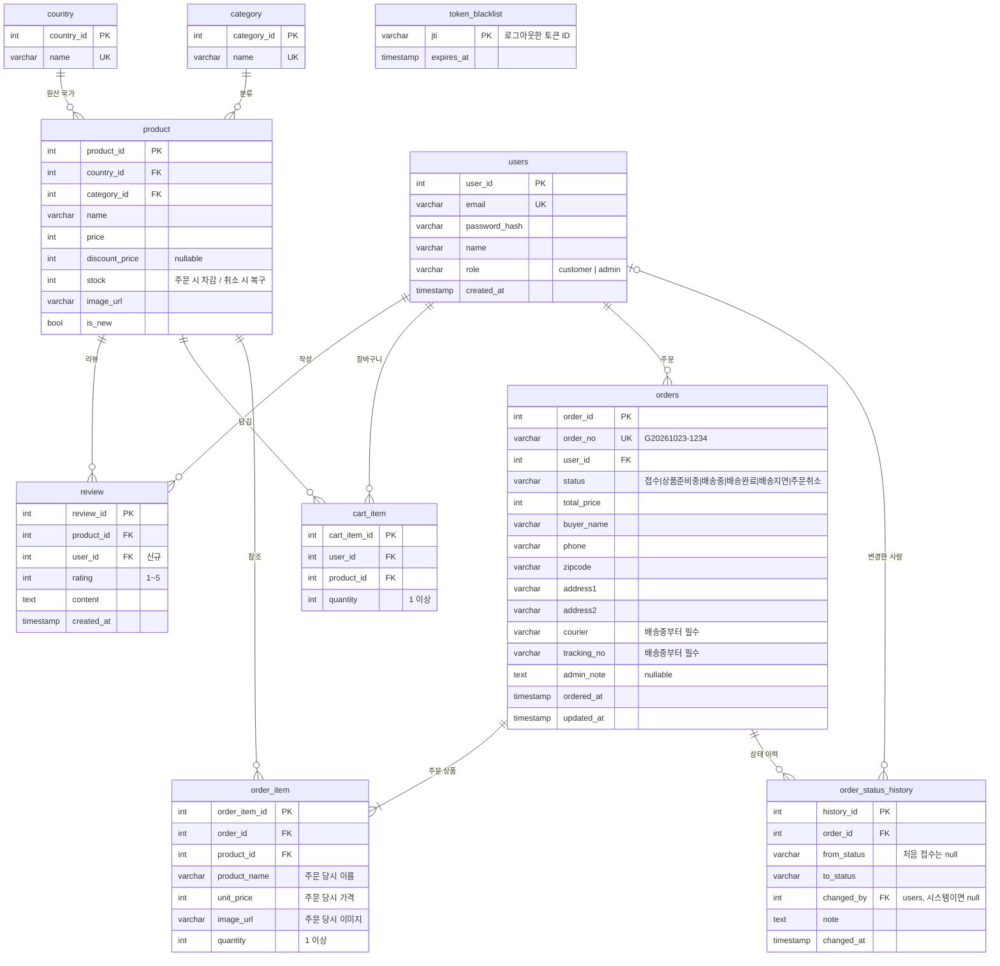

# ERD 초안 (SCRUM-9)

> 작성: C 담당 · 상태: **초안 — B·A와 합의 필요** (특히 `users`, `cart_item`, `orders`, `order_item`)
> 기준: `develop` 의 `infrastructure/*/models.py` (상품 · 리뷰는 인수 당시 모델 그대로)

## 다이어그램

## 테이블별 메모

| 테이블 | 담당 | 상태 | 핵심 제약 |
| --- | --- | --- | --- |
| `country`, `category`, `product` | A | 기존 유지 | `product.stock >= 0` 체크 추가 제안 |
| `review` | A | 변경 | `user_id` 추가, `UNIQUE(product_id, user_id)` (상품당 1인 1리뷰), `author_name` 은 `users.name` 으로 대체 검토 |
| `users` | B (공통) | 신규 | `email` UNIQUE, `role IN ('customer','admin')` 체크, 비밀번호는 해시만 저장 (`pwdlib[argon2]`) |
| `token_blacklist` | B (공통) | 신규 | 로그아웃한 JWT의 `jti` 저장, 만료 지난 행은 정리 가능 |
| `cart_item` | B | 신규 | `UNIQUE(user_id, product_id)`, `quantity >= 1` |
| `orders` | B 생성 · C 상태 변경 | 신규 | `status` 체크 제약 (값은 `domain/order/status.py` 와 동일), `order_no` UNIQUE |
| `order_item` | B | 신규 | 상품명 · 단가 · 이미지를 **주문 당시 값으로 복사** (상품 가격이 바뀌어도 주문 내역 유지), `ON DELETE CASCADE` (orders) |
| `order_status_history` | C | 신규 | 상태가 바뀔 때마다 한 줄 추가 (관리자 화면 이력 표시용) |

## 인덱스 제안

- `orders (status, ordered_at DESC)` — 관리자 목록: 상태 · 기간 필터
- `orders (user_id, ordered_at DESC)` — 내 주문 목록
- `order_status_history (order_id, changed_at)` — 주문 상세 이력
- 주문자 검색(`buyer_name`, `phone`, `order_no`)은 데이터가 적어서 우선 `ILIKE` 로 시작

## 트랜잭션 규칙

- **주문 생성 (B)**: `orders` + `order_item` 저장, `product.stock` 차감, `cart_item` 비우기, 첫 이력(`null → 접수`) 기록을 한 트랜잭션으로
- **관리자 취소 (C)**: 상태 변경 + `product.stock` 복구 + 이력 기록을 한 트랜잭션으로, 같은 주문을 동시에 바꾸지 않도록 `SELECT ... FOR UPDATE` 로 주문 행 잠금

## 합의할 것

- [ ] `orders.status` 를 한글 문자열로 저장할지 영문 코드(`RECEIVED` 등)로 저장할지 — 초안은 프론트와 같은 한글
- [ ] 관리자 취소 가능 범위 — 초안은 `접수`, `상품준비중` 에서만 (배송 이후는 불가)
- [ ] `review.author_name` 유지 여부
- [ ] 비회원 주문 허용 여부 — 초안은 로그인 사용자만 (`orders.user_id` NOT NULL)
