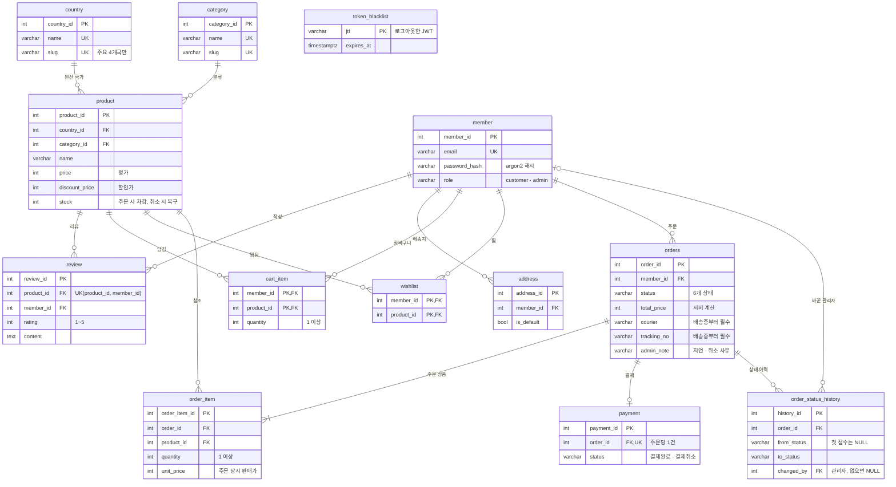
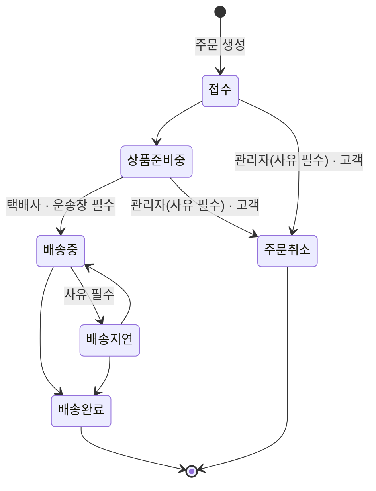

# ERD (SCRUM-9)

> 기준: `develop` 의 `backend/src/infrastructure/*/models.py` 와 Alembic 마이그레이션 head `a4f3fa9ce8d9` (2026-10-28).
> 처음 ERD(10/23)에서 "C 제안"으로 적었던 주문 배송 컬럼 · 상태 이력 테이블 · `orders (status, ordered_at)` 인덱스는 윤강 님과 합의해서 반영됐어요. 상태 값 CHECK 는 `orders.status` 가 아니라 이력 테이블(`order_status_history`)에 걸었고, `orders.status` 는 domain 계층이 검사해요.

## 한눈에

- **테이블 13개**를 여섯 묶음으로 나눠요. 인수 당시에는 `country` · `category` · `product` · `review` 4개뿐이었어요.
- 모든 테이블은 PostgreSQL 기본 스키마에 있고, 스키마 변경은 **Alembic 마이그레이션 6개**로만 해요 (아래 [마이그레이션 이력](#마이그레이션-이력)).
- 금액은 전부 원 단위 정수(`INTEGER`)예요. 시각은 시간대 없는 `TIMESTAMP` 이고, 로그아웃 토큰 만료 시각만 `TIMESTAMPTZ` 예요.
- 주문 · 결제 · 상태 이력 시각(`ordered_at` · `orders.updated_at` · `paid_at` · `changed_at`)은 앱이 한국 시간(KST)으로 넣고, 회원 · 리뷰 · 장바구니의 생성 시각과 리뷰 수정 시각(`review.updated_at`)은 DB `now()` 예요. DB 서버 시간대가 UTC 이면 두 무리가 9시간 차이 나요.

| 묶음 | 테이블 | 담당 | 하는 일 |
| --- | --- | --- | --- |
| 상품 | `country` · `category` · `product` | A 박진 | 나라 · 분류 · 상품 정보, 재고 |
| 리뷰 | `review` | A 박진 | 구매자 리뷰 (상품당 1인 1리뷰) |
| 회원 · 인증 | `member` · `address` · `token_blacklist` | B 윤강 | 회원, 배송지, 로그아웃한 토큰 |
| 장바구니 | `cart_item` · `wishlist` | B 윤강 | 회원별 장바구니 (찜은 테이블만) |
| 주문 | `orders` · `order_item` · `payment` | B 윤강 | 주문서, 주문 상품, 결제 |
| 관리자 주문 운영 | `order_status_history` | C 안중섭 | 주문 상태가 바뀔 때마다 한 줄 기록 |

## 다이어그램

읽는 법: `||--o{` 는 "하나 ↔ 0개 이상", `||--|{` 는 "하나 ↔ 1개 이상"(주문에는 상품이 꼭 하나 이상), `||--o|` 는 "하나 ↔ 0개 또는 1개"(주문당 결제 1건), `|o--o{` 는 "0개 또는 1개 ↔ 0개 이상"(이력의 관리자는 비어 있을 수 있음)이에요. `token_blacklist` 는 다른 테이블과 FK 없이 따로 있어서 선이 없어요. 그림에는 키와 핵심 열만 넣었고, 모든 열은 아래 [테이블 상세](#테이블-상세)에 있어요.

## 테이블 상세

제약 칸 표시: **PK** 기본 키 · **FK** 외래 키 · **UK** 유일 · **NN** 비어 있으면 안 됨. "기본"은 DB DEFAULT 이고, DB 가 아니라 ORM(파이썬)에서만 채우는 값은 "ORM 기본"이라고 적었어요. 타입 길이는 `varchar(n)` 의 n 이에요.

### 상품 (A 박진)

**`country`** 나라. 화면 탭은 주요 4개국 + "그 외"라서, `slug` 는 일본 `japan` · 대만 `taiwan` · 중국 `china` · 베트남 `vietnam` 에만 있고 나머지 나라는 NULL 이에요. API 는 NULL 을 `other` 로 내보내요.

| 열 | 타입 | 제약 | 설명 |
| --- | --- | --- | --- |
| `country_id` | integer | PK | |
| `name` | varchar(50) | UK, NN | 한글 나라 이름 |
| `slug` | varchar(30) | UK | 주소용 영문 (4개국만) |

**`category`** 분류 6개. 프론트 `gourmand/lib/categories.ts` 와 같은 값이고, `/category/{slug}` 주소에 그대로 쓰여요.

| 열 | 타입 | 제약 | 설명 |
| --- | --- | --- | --- |
| `category_id` | integer | PK | |
| `name` | varchar(50) | UK, NN | 스낵·칩, 쿠키·비스킷, 케이크·베이커리, 초콜릿, 젤리·캔디, 육포·견과·별미 |
| `slug` | varchar(30) | UK, NN | `snack` `cookie` `bakery` `chocolate` `candy` `savory` |

**`product`** 상품 62개 (일본 11 · 대만 10 · 중국 10 · 베트남 10 · 미국 10 · 프랑스 10 · 뉴질랜드 1). 시드 원본은 `backend/seed/products.json` 이에요.

| 열 | 타입 | 제약 | 설명 |
| --- | --- | --- | --- |
| `product_id` | integer | PK | 화면의 상품 번호와 같아요 |
| `country_id` | integer | FK → country, NN | |
| `category_id` | integer | FK → category, NN | |
| `name` · `manufacturer` | varchar(200) · varchar(100) | NN | 상품명 · 제조사 (검색 대상) |
| `description` | text | NN | 상세 설명 |
| `price` | integer | NN | 정가 |
| `discount_price` | integer | | 할인가. 정가보다 낮을 때만 이 값으로 팔아요 (범위 검사는 domain, DB CHECK 없음) |
| `image_url` | varchar(500) | NN | |
| `is_new` | boolean | NN, ORM 기본 false | 신상품 표시 |
| `stock` | integer | NN, ORM 기본 0 | 재고. 주문하면 줄고, 취소하면 돌아와요 |
| `delivery_days` | integer | NN | 예상 배송일 |
| `volume` · `unit` · `item_count` | numeric · varchar(10) · integer | NN (`item_count` ORM 기본 1) | 용량 · 단위 · 개수 |
| `origin` · `food_type` · `storage_method` | varchar(200) · varchar(100) · varchar(300) | NN | 원산지 · 식품 유형 · 보관 방법 (상세 정보 표) |

### 리뷰 (A 박진)

**`review`** 배송완료된 주문의 구매자만 쓸 수 있어요 (규칙은 domain 계층). 같은 상품에 같은 회원이 두 번 쓰는 건 **DB UNIQUE** 가 막아서, 동시에 두 번 눌러도 1건만 남아요.

| 열 | 타입 | 제약 | 설명 |
| --- | --- | --- | --- |
| `review_id` | integer | PK | |
| `product_id` | integer | FK → product (CASCADE), NN | |
| `member_id` | integer | FK → member (CASCADE), NN | 작성자 (SCRUM-25 에서 이름 문자열 대신 회원 연결) |
| `rating` | integer | NN, CHECK 1~5 | 별점 |
| `content` | text | NN | 본문 10~1,000자 (길이 검사는 domain) |
| `created_at` | timestamp | NN, 기본 now() | |
| `updated_at` | timestamp | | 수정하면 DB now(), 수정한 적 없으면 NULL |

제약: `uq_review_product_member (product_id, member_id)`. `product_id` 가 앞에 있어서 상품별 리뷰 목록 조회 인덱스도 겸해요.

### 회원 · 인증 (B 윤강)

**`member`** 회원. 비밀번호는 argon2 해시(`pwdlib`)만 저장해요.

| 열 | 타입 | 제약 | 설명 |
| --- | --- | --- | --- |
| `member_id` | integer | PK | |
| `email` | varchar(255) | UK, NN | 로그인 아이디 |
| `password_hash` | varchar(255) | NN | |
| `name` | varchar(50) | NN | |
| `phone` | varchar(20) | | |
| `role` | varchar(20) | NN, 기본 `customer` | `customer` · `admin`. 관리자 API 는 `admin` 만 (아니면 403) |
| `created_at` | timestamp | NN, 기본 now() | |

**`address`** 회원의 저장된 배송지. 주문서에서 "배송지 저장"을 고르면 그 주문의 받는 사람 · 주소로 기본 배송지(`is_default`) 한 줄을 채우고, 다음 주문서에서 불러와요. 주문 자체는 받는 사람 · 주소를 `orders` 에 따로 저장하기 때문에, 나중에 배송지를 바꿔도 지난 주문의 주소는 그대로예요.

| 열 | 타입 | 제약 | 설명 |
| --- | --- | --- | --- |
| `address_id` | integer | PK | |
| `member_id` | integer | FK → member (CASCADE), NN, 인덱스 | |
| `recipient` · `phone` | varchar(50) · varchar(20) | NN | 받는 사람 · 연락처 |
| `zipcode` | varchar(10) | NN | |
| `address1` · `address2` | varchar(200) | NN (`address2` 제외) | 기본 주소 · 상세 주소 |
| `is_default` | boolean | NN, 기본 false | 기본 배송지 |

**`token_blacklist`** 로그아웃한 access token 의 `jti`. 회원과 FK 로 잇지 않고 토큰 번호만 기록해요. 인증할 때 여기 있으면 401 이에요. 만료 시각이 지난 줄은 다음 로그아웃 때 지워서 테이블이 계속 커지지 않아요 (SCRUM-19).

| 열 | 타입 | 제약 | 설명 |
| --- | --- | --- | --- |
| `jti` | varchar(64) | PK | JWT 고유 번호 |
| `expires_at` | timestamptz | NN, 인덱스 | 토큰 만료 시각 |

### 장바구니 (B 윤강)

**`cart_item`** 회원별 서버 장바구니. `(member_id, product_id)` 가 기본 키라서, 같은 상품을 또 담으면 줄이 늘지 않고 수량이 더해져요. 가격은 저장하지 않고 주문할 때 `product` 의 현재 판매가로 계산해요.

| 열 | 타입 | 제약 | 설명 |
| --- | --- | --- | --- |
| `member_id` | integer | PK, FK → member (CASCADE) | |
| `product_id` | integer | PK, FK → product (CASCADE) | |
| `quantity` | integer | NN, 기본 1, CHECK ≥ 1 | |
| `added_at` | timestamp | NN, 기본 now() | |

**`wishlist`** 찜. 초기 스키마에 테이블만 만들어 두었고, 이번 범위에서는 API · 화면에서 쓰지 않아요.

| 열 | 타입 | 제약 | 설명 |
| --- | --- | --- | --- |
| `member_id` | integer | PK, FK → member (CASCADE) | |
| `product_id` | integer | PK, FK → product (CASCADE) | |
| `created_at` | timestamp | NN, 기본 now() | |

### 주문 (B 윤강, 배송 컬럼은 C 안중섭)

**`orders`** 주문서. 예약어 `order` 를 피해서 복수형 이름이에요. 받는 사람 · 주소는 주문서에 입력한 값을 이 주문에 그대로 저장해요.

| 열 | 타입 | 제약 | 설명 |
| --- | --- | --- | --- |
| `order_id` | integer | PK | 화면의 주문 번호 |
| `member_id` | integer | FK → member, NN, 인덱스 | 주문한 회원 |
| `status` | varchar(20) | NN, 기본 `접수` | 아래 [주문 상태](#주문-상태와-결제-상태) |
| `total_price` | integer | NN, CHECK ≥ 0 | 서버가 DB 판매가로 계산한 합계 |
| `recipient` · `phone` | varchar(50) · varchar(20) | NN | |
| `zipcode` · `address1` · `address2` | varchar(10) · varchar(200) · varchar(200) | NN (`address2` 제외) | |
| `ordered_at` | timestamp | NN, 기본 now() | |
| `courier` | varchar(20) | | 택배사 (CJ대한통운 · 우체국택배 · 한진택배 · 롯데택배). 첫 출고(상품준비중 → 배송중) 때 필수, 배송지연 → 배송중은 이미 적힌 값을 그대로 써요 |
| `tracking_no` | varchar(30) | | 운송장. 숫자 · 하이픈 8~20자. 필수 조건은 `courier` 와 같아요 |
| `admin_note` | varchar(300) | | 관리자가 마지막으로 적은 사유 · 메모 (배송지연 · 주문취소 때 필수). 고객 취소는 쓰지 않아요 |
| `updated_at` | timestamp | NN, 기본 now() | 마지막 변경 시각 (바뀔 때 앱이 갱신) |

인덱스: `ix_orders_status_ordered_at (status, ordered_at)` — 관리자 목록의 상태 · 기간 필터와 상태별 개수 요약에 써요 (SCRUM-34).

**`order_item`** 주문에 담긴 상품. `unit_price` 에 주문 당시 판매가를 남겨서, 나중에 상품 가격이 바뀌어도 지난 주문 금액은 그대로예요.

| 열 | 타입 | 제약 | 설명 |
| --- | --- | --- | --- |
| `order_item_id` | integer | PK | |
| `order_id` | integer | FK → orders (CASCADE), NN, 인덱스 | |
| `product_id` | integer | FK → product, NN, 인덱스 | 주문 내역이 있는 상품은 지울 수 없어요 |
| `quantity` | integer | NN, CHECK ≥ 1 | |
| `unit_price` | integer | NN, CHECK ≥ 0 | 주문 당시 판매가 |

**`payment`** 결제. 실제 PG 연동은 없어서, 주문하면 바로 `결제완료`(수단 `카드`)로 저장해요.

| 열 | 타입 | 제약 | 설명 |
| --- | --- | --- | --- |
| `payment_id` | integer | PK | |
| `order_id` | integer | FK → orders (CASCADE), UK, NN | 주문당 1건 |
| `method` | varchar(30) | NN | 시연용 `카드` |
| `amount` | integer | NN | |
| `status` | varchar(20) | NN | `결제완료` · `결제취소` |
| `paid_at` | timestamp | | |

### 관리자 주문 운영 (C 안중섭)

**`order_status_history`** 주문 상태가 바뀔 때마다 한 줄씩 쌓여요. 주문 생성(`NULL → 접수`), 관리자 변경, 고객 취소가 모두 남아요. 관리자 상세 화면은 이 이력으로 단계별 처리 시각을 보여 주고, 바꾼 관리자(`changed_by`)는 감사 기록으로 DB 에 남겨요.

| 열 | 타입 | 제약 | 설명 |
| --- | --- | --- | --- |
| `history_id` | integer | PK | |
| `order_id` | integer | FK → orders (CASCADE), NN | |
| `from_status` | varchar(20) | CHECK 6개 상태 중 하나 또는 NULL | 첫 접수는 NULL |
| `to_status` | varchar(20) | NN, CHECK 6개 상태 중 하나 | |
| `changed_by` | integer | FK → member (SET NULL) | 바꾼 관리자. 고객 취소 · 주문 생성은 NULL. 회원이 지워져도 이력은 남아요 |
| `note` | varchar(300) | | 관리자가 적은 사유 · 메모. 택배사 · 운송장은 여기가 아니라 `orders` 에 남아요 |
| `changed_at` | timestamp | NN, 기본 now() | |

인덱스: `ix_order_status_history_order_changed (order_id, changed_at)` — 한 주문의 이력을 시간순으로 읽어요.

## 제약 · 인덱스 모음

규칙의 1차 검사는 domain 계층이 하고, DB 는 동시 요청이나 실수로 잘못된 값이 들어오는 것을 마지막에 막아요.

| 종류 | 이름 | 대상 | 막는 것 |
| --- | --- | --- | --- |
| CHECK | `ck_review_rating` | `review.rating BETWEEN 1 AND 5` | 범위 밖 별점 |
| CHECK | `ck_cart_item_quantity` | `cart_item.quantity >= 1` | 0개 담기 |
| CHECK | `ck_orders_total_price` | `orders.total_price >= 0` | 음수 금액 |
| CHECK | `ck_order_item_quantity` · `ck_order_item_unit_price` | `order_item` 수량 ≥ 1, 단가 ≥ 0 | |
| CHECK | `ck_order_status_history_to_status` · `ck_order_status_history_from_status` | 이력의 6개 상태 값 | 없는 상태 기록 |
| (DB 없음) | — | `orders.status` | DB CHECK 없이 domain 이 검사: 관리자 전이는 `ADMIN_TRANSITIONS`, 고객 취소는 `CUSTOMER_CANCELLABLE` (`backend/src/domain/order/status.py`) |
| UNIQUE | `uq_review_product_member` | `review (product_id, member_id)` | 1인 2리뷰 (동시 작성 포함) |
| UNIQUE | — | `member.email`, `payment.order_id`, `country.name/slug`, `category.name/slug` | 중복 가입, 주문당 결제 2건 |
| INDEX | `ix_orders_status_ordered_at` | `orders (status, ordered_at)` | 관리자 목록 · 요약 |
| INDEX | `ix_order_status_history_order_changed` | `order_status_history (order_id, changed_at)` | 주문별 이력 |
| INDEX | `ix_orders_member_id` · `ix_address_member_id` · `ix_order_item_order_id` · `ix_order_item_product_id` · `ix_token_blacklist_expires_at` | FK · 만료 시각 | 내 주문 · 배송지 · 주문 상품 조회, 만료 토큰 정리 |

## 지울 때 함께 지워지는 것 (ON DELETE)

| 지우는 행 | 함께 지워짐 (CASCADE) | 남는 것 |
| --- | --- | --- |
| `member` | `address`, `review`, `cart_item`, `wishlist` | 주문이 있는 회원은 지울 수 없어요 (`orders.member_id` 는 CASCADE 없음). 이력의 `changed_by` 는 NULL 로 바뀌어요 |
| `product` | `review`, `cart_item`, `wishlist` | 주문 내역이 있는 상품은 지울 수 없어요 (`order_item.product_id`) |
| `orders` | `order_item`, `payment`, `order_status_history` | |

주문과 결제는 기록이라서, 회원이나 상품을 지우는 것으로 사라지지 않게 일부러 막아 뒀어요.

## 주문 상태와 결제 상태

`orders.status` 값은 한글 문자열이고, 프론트(`gourmand/lib/orderStorage.ts`) · domain(`backend/src/domain/order/status.py`) · 이력 CHECK 가 같은 6개 값을 써요.

- 위에 없는 전이는 409 (`BUSINESS_RULE_VIOLATION`) 예요. 택배사 · 운송장 · 사유가 빠지거나 규칙(택배사 4곳, 운송장 숫자 · 하이픈 8~20자)에 안 맞으면 422 `INVALID_VALUE`, 요청 형식 자체가 틀리면(없는 상태 값, 길이 초과) 422 `VALIDATION_ERROR` 예요.
- 고객은 `접수` · `상품준비중` 에서만 직접 취소할 수 있어요. 배송중부터는 409.
- `payment.status`: 주문하면 `결제완료`, 관리자 취소든 고객 취소든 취소되면 `결제취소`.

## 트랜잭션과 잠금

| 작업 | 한 트랜잭션에 묶는 것 | 잠금 |
| --- | --- | --- |
| 장바구니 담기 (B) | `cart_item` 추가 또는 수량 합산 | `member` 행 → `cart_item` 행 `FOR UPDATE`. 같은 상품을 처음 담는 요청이 동시에 와도 하나씩 처리 (SCRUM-69) |
| 주문 생성 (B) | `orders` · `order_item` · `payment(결제완료)` 저장, `product.stock` 차감, 주문한 상품의 `cart_item` 삭제(그사이 새로 담은 상품은 남음), 이력 `NULL → 접수`, "배송지 저장"이면 `address` 갱신 | `cart_item` 행과 `product` 행을 **상품 번호 순서로** `FOR UPDATE` → 주문끼리 교착 상태 방지, 재고 초과 판매 없음 |
| 관리자 상태 변경 (C) | `orders.status` (+ 택배사 · 운송장 · `admin_note`) 변경, 이력 한 줄 | `orders` 행 `FOR UPDATE` 후 전이 규칙 검사 |
| 취소 (관리자 C · 고객 B) | 상태 `주문취소`, 이력, `product.stock` 복구, `payment` → `결제취소` (관리자는 `admin_note` 사유도) | `orders` 행 `FOR UPDATE` → `product` 행을 상품 번호 순서로 `FOR UPDATE`. 동시에 두 번 취소하면 두 번째는 409라서 재고가 두 번 돌아오지 않아요 |

커밋은 application 계층(service)이 해요. 주문 · 취소 · 상태 변경은 하나라도 실패하면 service 가 전체를 롤백하고, 장바구니는 오류가 나면 커밋하지 않은 채 요청 세션이 닫히면서 롤백돼요.

## 마이그레이션 이력

`backend/migrations/versions/`, 오래된 것부터. 새 환경은 `uv run alembic upgrade head` 한 번이면 이 순서대로 적용돼요.

| 순서 | revision | 티켓 | 바뀐 것 |
| --- | --- | --- | --- |
| 1 | `509a0c2d7dc1` | SCRUM-8 | 초기 스키마 11개: `country` · `category` · `product` · `review`(작성자 이름 `author_name`) · `member` · `address` · `cart_item` · `wishlist` · `orders` · `order_item` · `payment` |
| 2 | `c3a1f0e2b7d4` | SCRUM-33 | `order_status_history` 추가 (상태 CHECK, 주문별 인덱스) |
| 3 | `931e63404b05` | SCRUM-21 | `country.slug` · `category.slug` 추가 (기존 행 채운 뒤 UNIQUE) |
| 4 | `d7e2b9a4c1f6` | SCRUM-35 | `orders` 에 `courier` · `tracking_no` · `admin_note` · `updated_at`, 인덱스 `(status, ordered_at)` |
| 5 | `e4b8c2d1a9f3` | SCRUM-19 | `token_blacklist` 추가 (로그아웃) |
| 6 | `a4f3fa9ce8d9` | SCRUM-25 | `review.author_name` 대신 `member_id` (FK, CASCADE) · `updated_at`, UNIQUE `(product_id, member_id)`. 기존 리뷰 행은 모두 지워요 (시드 리뷰는 `uv run python scripts/seed.py` 를 돌리면 다시 들어가요) |

## 인수 전과 비교

| | 인수 전 (원본 9d162f6) | 지금 |
| --- | --- | --- |
| 테이블 | 4개 (`country` · `category` · `product` · `review`), 화면은 이 DB를 쓰지 않음 | 13개, `wishlist` 를 뺀 12개를 화면이 API 로 사용 |
| 스키마 관리 | 동기 SQLAlchemy + 수동 비교 스크립트 | 비동기 SQLAlchemy 모델 + Alembic 6개 |
| 리뷰 | 작성자 이름 문자열 | 회원 FK + 1인 1리뷰 UNIQUE |
| 장바구니 · 주문 | 브라우저 sessionStorage · localStorage | `cart_item` · `orders` · `order_item` · `payment` |
| 관리자 | 코드에 넣은 예시 주문 14건 + 같은 브라우저의 주문(localStorage). 실제 주문의 상태 변경은 그 브라우저 localStorage 에만 저장(마이페이지에 반영), 예시 주문은 화면에서만 | 상태 이력 테이블(상태 CHECK) · 배송 컬럼 · 서버 전이 규칙 |
