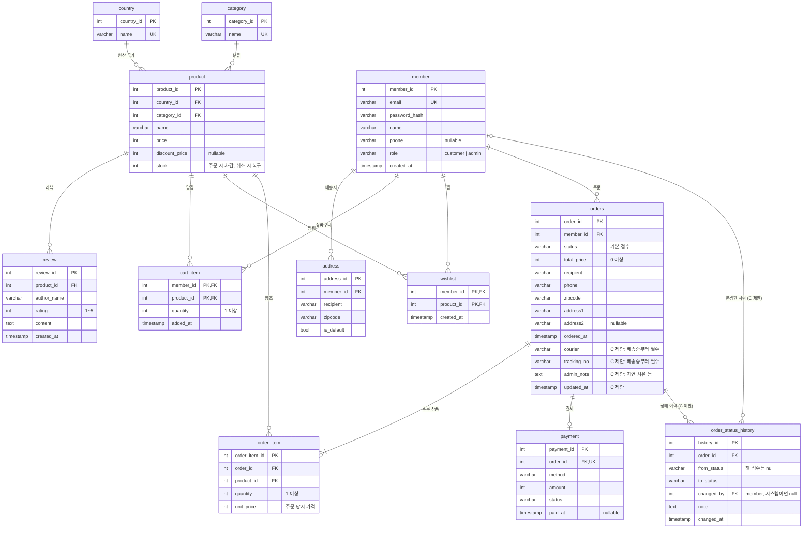

# ERD (SCRUM-9)

> 기준: `develop` 의 `infrastructure/*/models.py` (SCRUM-8 ORM 모델 반영)
> **현재 모델 그대로** + **C(관리자 주문 운영)가 추가를 제안하는 부분**을 구분해서 적었어요. 제안 부분은 B·A와 합의 후 반영합니다.

## 다이어그램

## C가 제안하는 변경 (합의 필요)

| 대상 | 변경 | 이유 | 관련 티켓 |
| --- | --- | --- | --- |
| `orders` | `courier`, `tracking_no` (nullable `String`) 추가 | 배송중으로 바꿀 때 택배사 · 운송장 필수 (관리자 화면에 이미 입력칸 있음) | SCRUM-35 |
| `orders` | `admin_note` (nullable `Text`) 추가 | 배송지연 사유 메모 (관리자 화면 `adminNote`) | SCRUM-35 |
| `orders` | `updated_at` 추가 | 마지막 상태 변경 시각 | SCRUM-35 |
| `orders` | `status` 에 체크 제약 `IN ('접수','상품준비중','배송중','배송완료','배송지연','주문취소')` | 잘못된 값 저장 방지. 값은 `domain/order/status.py` · 프론트와 동일 | SCRUM-32 |
| `order_status_history` | 신규 테이블 | 상태가 바뀔 때마다 한 줄 기록 (관리자 화면 이력 표시, 고객 취소도 기록) | SCRUM-33 |
| 인덱스 | `orders (status, ordered_at)` | 관리자 목록 상태 · 기간 필터 | SCRUM-34 |

`order_status_history` 는 C가 `infrastructure/admin/models.py` 에 만들어서 B의 `order/models.py` 파일과 겹치지 않게 할게요.
`orders` 컬럼 추가는 B 파일이라 **B가 추가하거나, C가 PR로 올리고 B가 리뷰**하는 방식 중 정해야 해요.

## 트랜잭션 규칙

- **주문 생성 (B)**: `orders` + `order_item` 저장, `product.stock` 차감, `cart_item` 비우기, 첫 이력(`null → 접수`)을 한 트랜잭션으로
- **관리자 상태 변경 · 취소 (C)**: 상태 변경 + 이력 기록 (+ 취소면 `product.stock` 복구)을 한 트랜잭션으로. 같은 주문을 동시에 바꾸지 않게 `SELECT ... FOR UPDATE` 로 주문 행을 잠가요

## 합의할 것

- [ ] 위 `orders` 컬럼 추가를 누가 반영할지
- [ ] 관리자 취소 가능 범위 — 제안: `접수`, `상품준비중` 에서만
- [ ] 취소 시 `payment.status` 를 함께 바꿀지 (예: `취소`)
