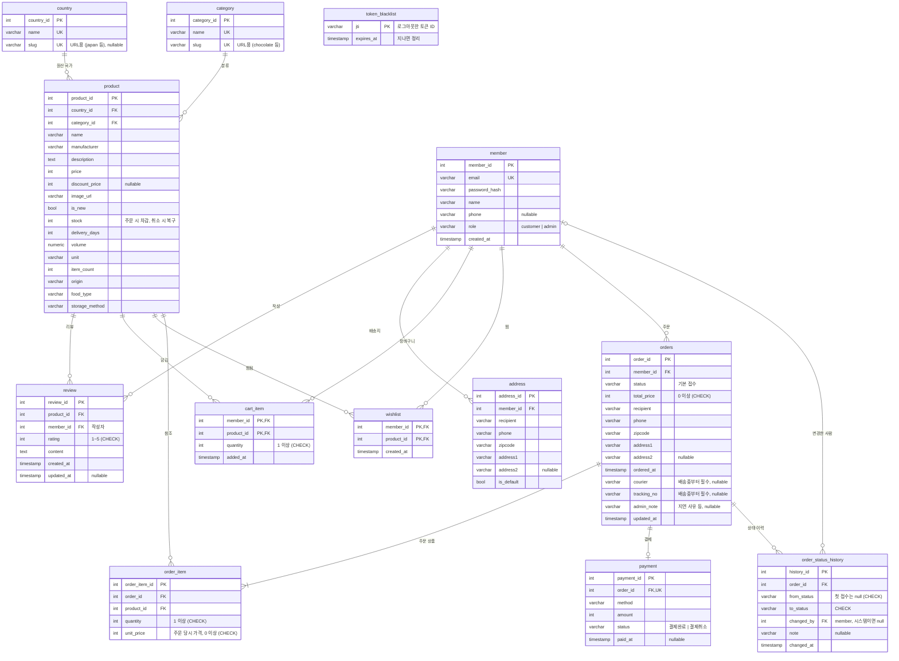

# ERD (SCRUM-9)

> 기준: `develop` 의 `infrastructure/*/models.py` 와 `backend/migrations/versions` (2026-10-28)
> 테이블 12개. 처음 초안에서 C가 제안한 `orders` 배송 컬럼 · `order_status_history` · 인덱스는 모두 반영됐어요.

## 다이어그램

`token_blacklist` 는 다른 테이블과 FK 없이 따로 있어요 (로그아웃 시 토큰 ID 기록, 인증할 때 확인).

## 제약 · 인덱스

| 대상 | 내용 |
| --- | --- |
| `order_status_history` | `from_status` · `to_status` 체크 제약 `IN ('접수','상품준비중','배송중','배송완료','배송지연','주문취소')`. 값은 `domain/order/status.py` · 프론트와 같아요 |
| `orders.status` | DB 체크 제약은 없고, 도메인(`ADMIN_TRANSITIONS`)에서 허용된 전이만 막아요 |
| 인덱스 | `orders (status, ordered_at)` 관리자 목록 필터 · `order_status_history (order_id, changed_at)` · `orders.member_id` · `order_item.order_id` · `order_item.product_id` · `address.member_id` · `token_blacklist.expires_at` |

## 상태 · 취소 규칙

- 관리자 상태 변경: 접수 → 상품준비중 → 배송중 → 배송완료 (배송중 ↔ 배송지연). 배송지연 · 주문취소는 사유 필수
- 취소 가능: `접수` · `상품준비중` 에서만 (관리자 · 고객 같음)
- 취소하면 `payment.status` 를 `결제취소` 로 바꾸고 `product.stock` 을 복구해요

## 트랜잭션 규칙

- **주문 생성 (B)**: `orders` + `order_item` + `payment` 저장, `product.stock` 차감, 주문한 상품만 `cart_item` 에서 빼기 (+ 배송지 저장 선택), 첫 이력(`null → 접수`)을 한 트랜잭션으로
- **관리자 상태 변경 · 취소 (C)**: 상태 변경 + 이력 기록 (+ 취소면 `payment` 결제취소 · `product.stock` 복구)을 한 트랜잭션으로. 같은 주문을 동시에 바꾸지 않게 `SELECT ... FOR UPDATE` 로 주문 행을 잠가요
