# [A 상품·리뷰] 실패 케이스 · 로그아웃 후 401 검증 (SCRUM-37 · 38)

확인일: 2026-10-26 · 로컬(`localhost:8000` Swagger, `localhost:3000` 화면, PostgreSQL `psql` 재조회)
자동 테스트: [`backend/tests/test_review_failures.py`](../../backend/tests/test_review_failures.py) (19개), [`test_review_api.py`](../../backend/tests/test_review_api.py), [`test_product_api.py`](../../backend/tests/test_product_api.py)

## 요약

| 코드 | 상황 | 응답 `code` / `message` | DB |
|---|---|---|---|
| 401 | 토큰 없이 작성 · 수정 · 삭제 | `UNAUTHORIZED` / 로그인이 필요해요. | 그대로 |
| 401 | 깨진 · 위조된 토큰, 없는 회원 | `UNAUTHORIZED` / 로그인 정보가 올바르지 않아요. 다시 로그인해 주세요. | 그대로 |
| 401 | 만료된 토큰 | `UNAUTHORIZED` / 로그인이 만료됐어요. 다시 로그인해 주세요. | 그대로 |
| 401 | **로그아웃한 같은 토큰** (SCRUM-38) | `UNAUTHORIZED` / 로그아웃된 토큰이에요. 다시 로그인해 주세요. | 그대로 |
| 403 | 남의 리뷰 수정 · 삭제 | `FORBIDDEN` / 본인이 작성한 리뷰만 수정(삭제)할 수 있어요. | 그대로 |
| 404 | 없는 상품 · 리뷰 · 주소 | `NOT_FOUND` / 상품을 · 리뷰를 · 요청한 주소를 찾을 수 없어요. | — |
| 405 | `PUT /reviews/{id}` | `METHOD_NOT_ALLOWED` | — |
| 409 | 같은 상품에 두 번째 리뷰 | `CONFLICT` / 이미 이 상품에 리뷰를 작성했어요. | 1개 그대로 |
| 422 | 별점 0 · 6, 내용 10자 미만 · 1000자 초과, 빈 수정, 잘못된 쿼리 · 경로, 깨진 JSON | `VALIDATION_ERROR` | 그대로 |

- **400은 나지 않아요.** 형식 오류는 공통 규칙대로 모두 422 `VALIDATION_ERROR`예요 (깨진 JSON도 422).
- **상품 API는 공개라서** 401 · 403이 없어요 (404 · 422만 해당).
- 로그아웃한 토큰으로도 **공개 목록 · 상품 상세는 200**이에요 (`isMine`만 false).

## Swagger (`/docs`)

### 401 토큰 없이 작성
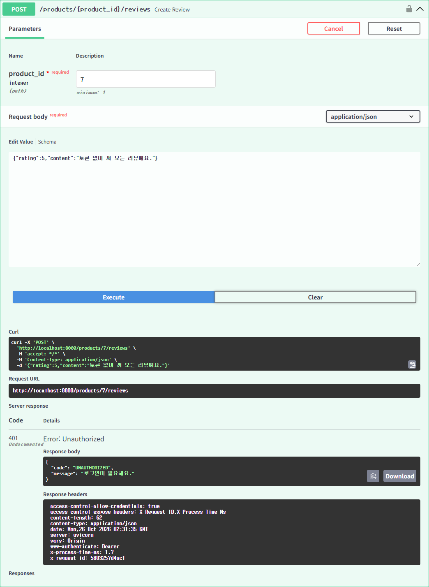

### 422 별점 6
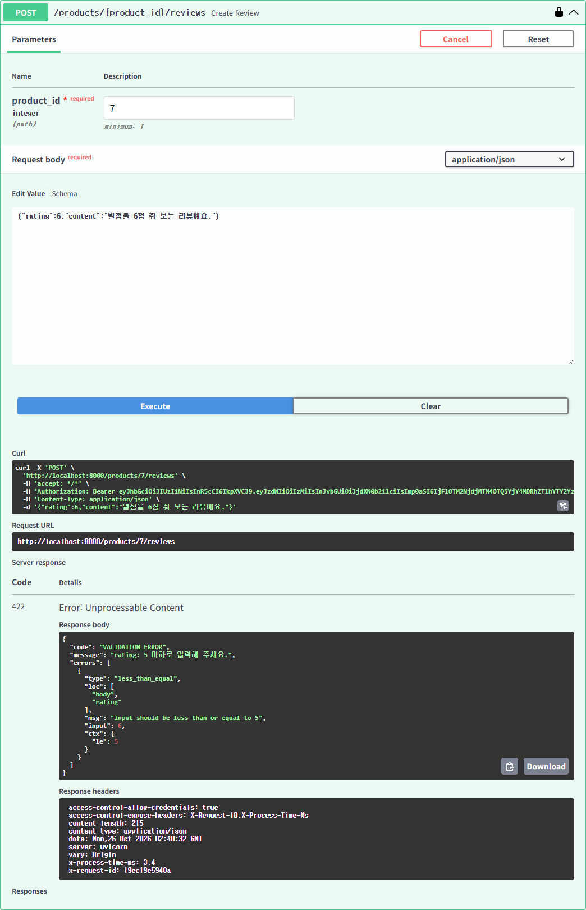

### 404 없는 상품
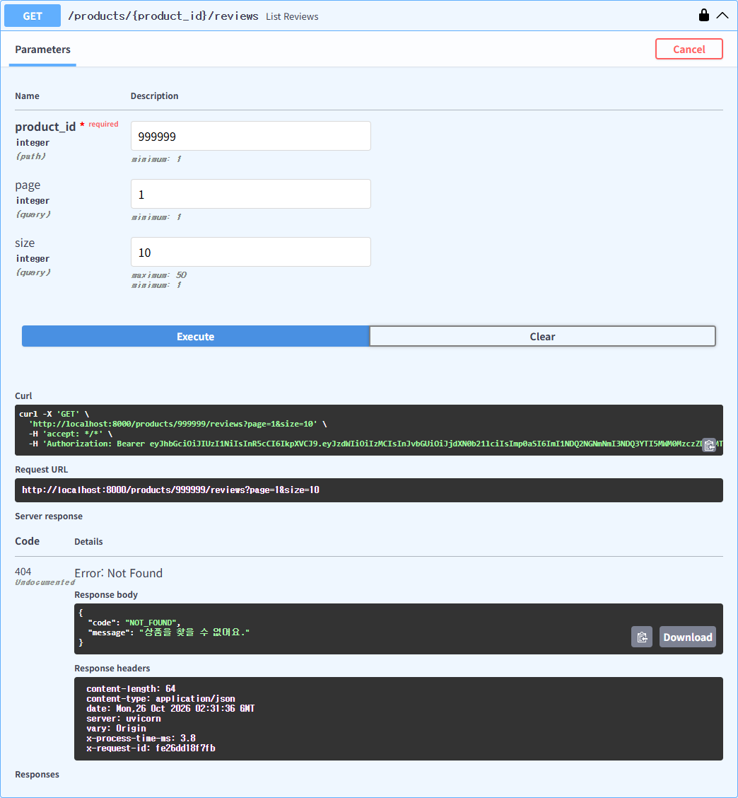

### 403 남의 리뷰 수정 + DB 재조회
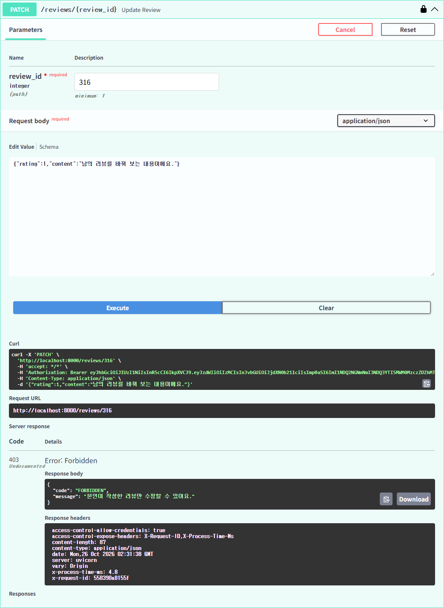

```
-- 403 전 (review_id=316)
 review_id |  name  | rating |              content              | updated_at
       316 | 김구르 |      5 | 양이 조금 아쉽지만 맛은 확실해요. |
-- 403 후: 그대로
       316 | 김구르 |      5 | 양이 조금 아쉽지만 맛은 확실해요. |
```

### 409 같은 상품에 두 번째 리뷰 + DB 재조회
첫 작성(201) → 두 번째(409)

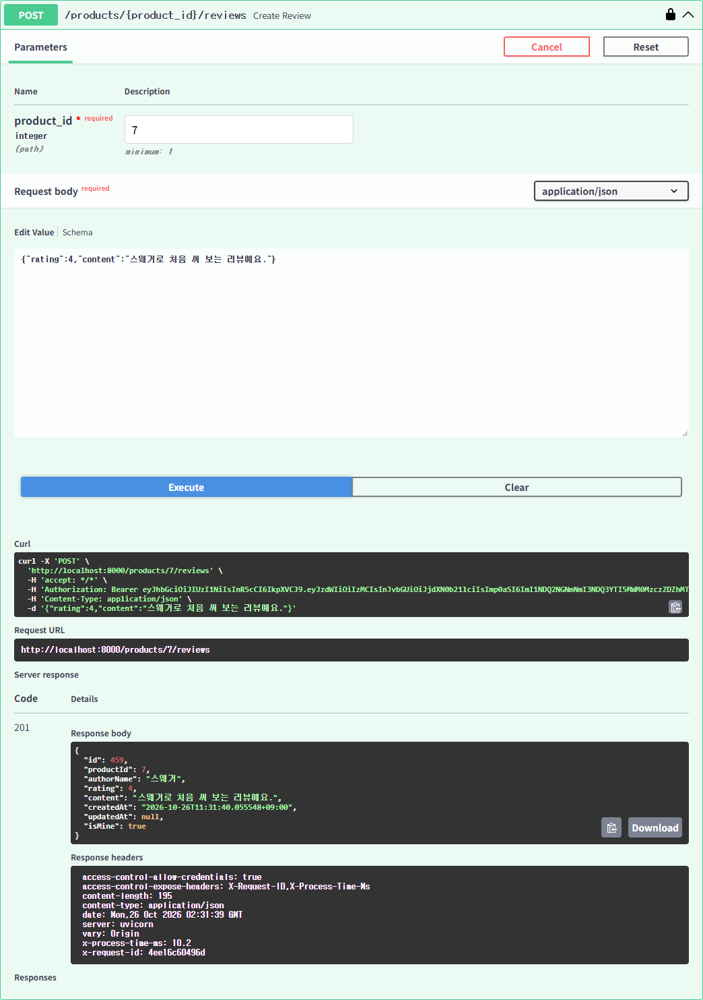
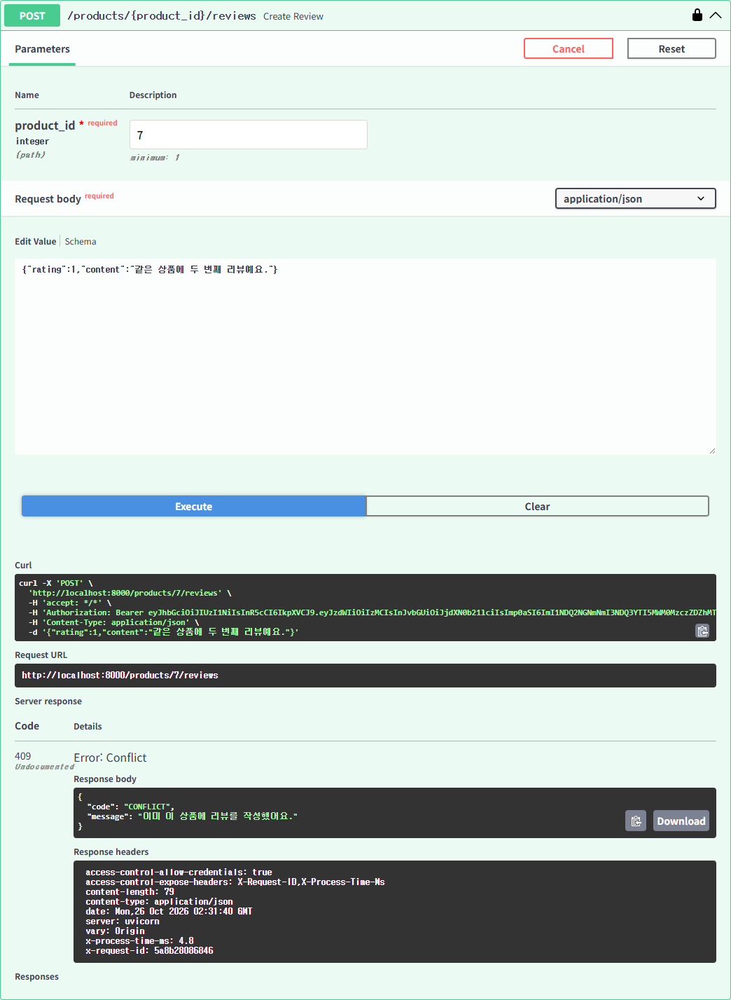

```
-- 409 후: 내 리뷰 1개, 첫 리뷰(4점) 그대로
 review_id |  name  | rating |             content             | updated_at
       459 | 스웨거 |      4 | 스웨거로 처음 써 보는 리뷰예요. |
```

### SCRUM-38 로그인 → 작성 성공 → 로그아웃 → 같은 토큰 401
Swagger `Authorize`로 로그인 → 위 201 작성 → `POST /auth/logout` 204 → 같은 토큰으로 `PATCH` 401

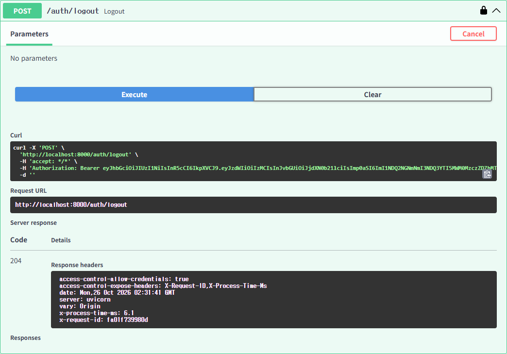
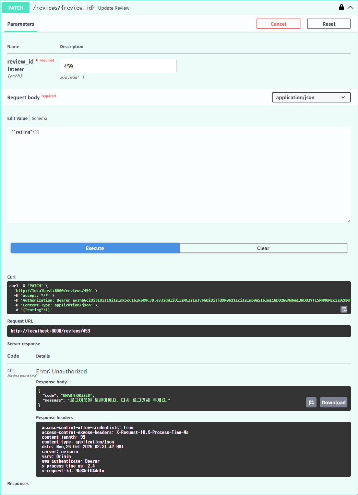

```
-- 로그아웃 뒤 수정 시도 후: 4점 그대로 (updated_at 없음)
       459 | 스웨거 |      4 | 스웨거로 처음 써 보는 리뷰예요. |
```

## 화면 (상품 상세 리뷰)

| 상황 | 화면 |
|---|---|
| 10자 미만: 보내기 전에 안내 | 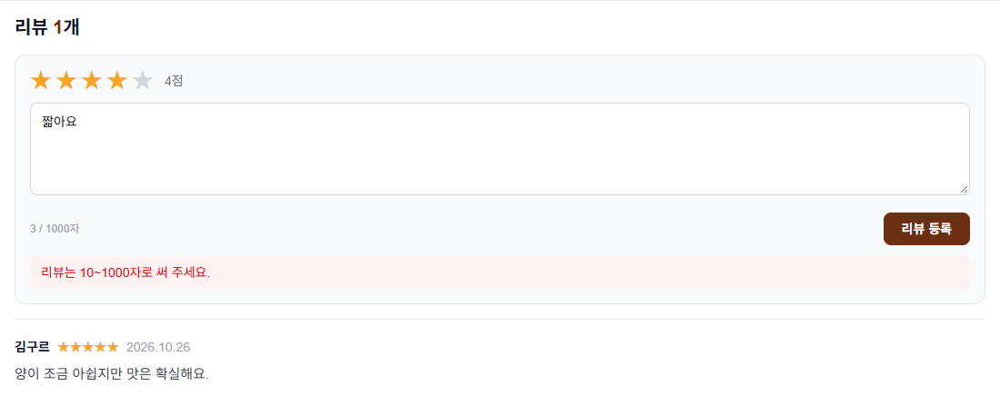 |
| 다른 탭에서 이미 작성 → 409 메시지 그대로 | 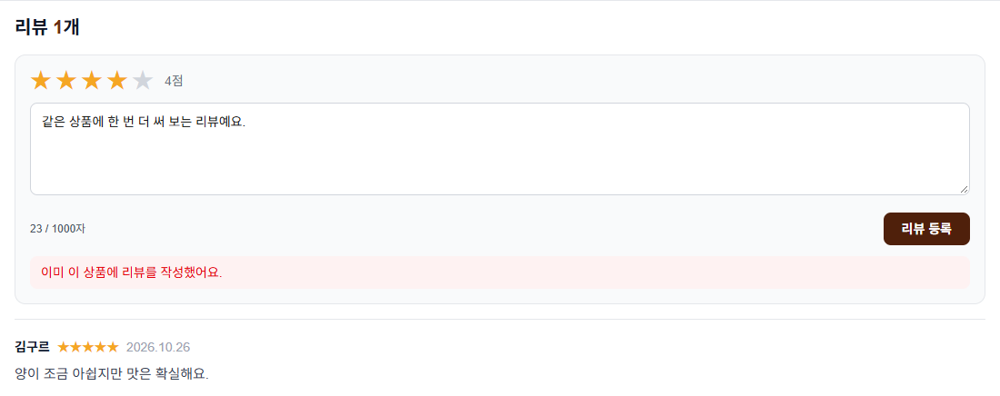 |
| 다른 곳에서 로그아웃 → 수정 시도 → 로그인 화면(`?next=/products/7`)으로, 저장된 토큰 삭제 | 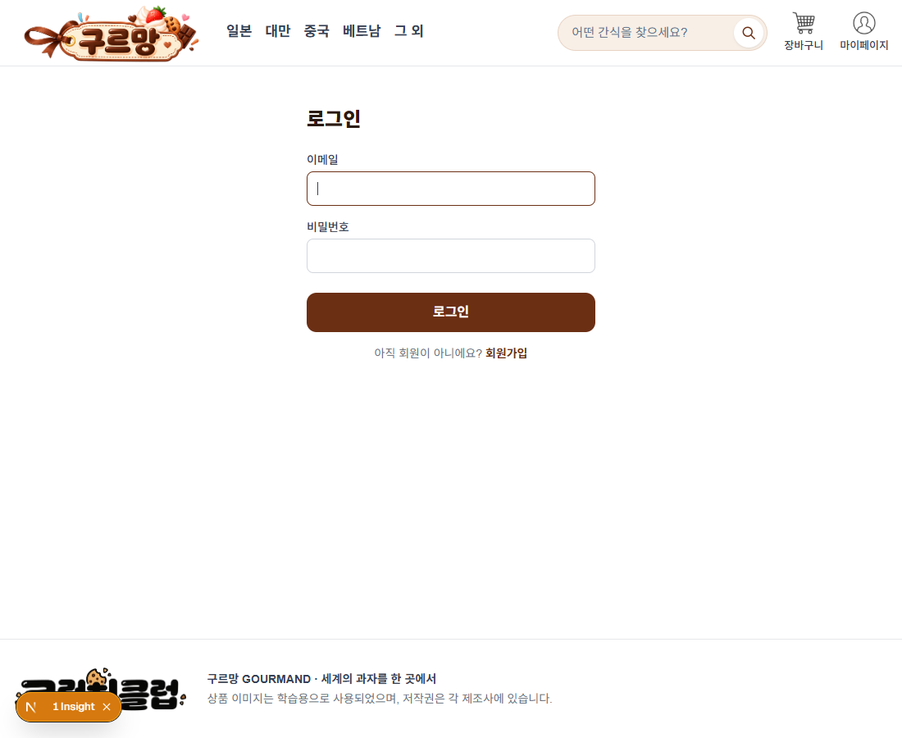 |
| 없는 상품 `/products/999999` → 404 화면 | 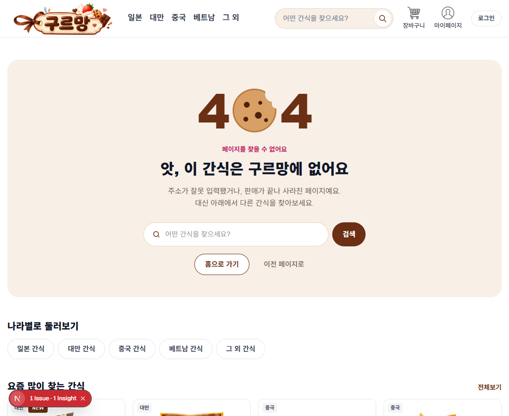 |

화면에서 확인한 DB:

```
-- 409 후: 다른 탭에서 쓴 리뷰 1개만
       460 |      5 | 다른 탭에서 먼저 쓴 리뷰예요.
-- 로그아웃 뒤 수정 시도 후: 5점 그대로, updated_at 없음
       460 |      5 |
```

캡처에 쓴 계정 · 리뷰는 확인 뒤 지웠어요.

## 남은 점

- ~~422 형식 오류 `message`가 Pydantic 영어 문장~~ → 팀 합의(필드 이름은 영어 유지)대로 우리말로 바꿨어요: `rating: 5 이하로 입력해 주세요.` (위 Swagger 422 캡처는 바뀐 뒤 화면)
- 화면에서 409가 나면 메시지만 보여 주고 목록은 다시 불러오지 않아요. 새로고침하면 내 리뷰가 보여요.
