# [B 장바구니·주문] 실패 케이스 · 로그아웃 후 401 검증 (SCRUM-40 · 41)

확인일: 2026-10-26 · 로컬 임시 DB(마이그레이션 + 시드)로 띄운 Swagger(`/docs`) · 화면, DB 재조회
자동 테스트: [`backend/tests/test_cart_order_failures.py`](../../backend/tests/test_cart_order_failures.py) (28개), [`test_cart_api.py`](../../backend/tests/test_cart_api.py), [`test_order_api.py`](../../backend/tests/test_order_api.py), [`test_my_orders_api.py`](../../backend/tests/test_my_orders_api.py)

## 요약

| 코드 | 상황 | 응답 `code` / `message` | DB |
|---|---|---|---|
| 401 | 토큰 없이 장바구니 · 주문 요청 (조회 포함 9개 전부) | `UNAUTHORIZED` / 로그인이 필요해요. | 그대로 |
| 401 | 깨진 · 위조된 토큰, 없는 회원 | `UNAUTHORIZED` / 로그인 정보가 올바르지 않아요. 다시 로그인해 주세요. | 그대로 |
| 401 | 만료된 토큰 | `UNAUTHORIZED` / 로그인이 만료됐어요. 다시 로그인해 주세요. | 그대로 |
| 401 | **로그아웃한 같은 토큰** (SCRUM-41) | `UNAUTHORIZED` / 로그아웃된 토큰이에요. 다시 로그인해 주세요. | 그대로 |
| 403 | 남의 주문 조회 · 취소 | `FORBIDDEN` / 본인 주문만 볼 수 있어요. | 그대로 |
| 404 | 없는 상품 담기 | `NOT_FOUND` / 상품을 찾을 수 없어요. | — |
| 404 | 장바구니에 없는 상품 수량 변경 · 빼기 (남의 장바구니 상품 포함) | `NOT_FOUND` / 장바구니에 없는 상품이에요. | 그대로 |
| 404 | 없는 주문 조회 · 취소, 없는 주소 | `NOT_FOUND` / 주문을 · 요청한 주소를 찾을 수 없어요. | — |
| 405 | `PUT /cart`, `PUT · DELETE /orders/{id}` | `METHOD_NOT_ALLOWED` / 이 주소에서는 지원하지 않는 요청 방식이에요. | — |
| 409 | 품절 상품 담기 | `BUSINESS_RULE_VIOLATION` / '품절과자' 상품이 품절이에요. | 그대로 |
| 409 | 재고보다 많이 담기 · 합쳐서 재고 초과 · 수량 변경 초과 | `BUSINESS_RULE_VIOLATION` / '…' 재고가 부족해요. (최대 N개까지 담을 수 있어요) | 장바구니 그대로 |
| 409 | 빈 장바구니로 주문 | `BUSINESS_RULE_VIOLATION` / 장바구니가 비어 있어요. | 주문 없음 |
| 409 | 주문하는 사이 재고 부족 | `BUSINESS_RULE_VIOLATION` / '…' 재고가 부족해요. (남은 수량 N개) | **전체 롤백**: 재고 · 장바구니 그대로, 주문 · 결제 없음 |
| 409 | 배송중 · 배송완료 · 배송지연 · 이미 취소한 주문 취소 | `BUSINESS_RULE_VIOLATION` / '배송중' 상태의 주문은 취소할 수 없어요. 고객센터에 문의해 주세요. | 재고 복구 없음, 결제완료 그대로 |
| 422 | 수량 0 · 1000, 상품 번호가 글자 · 없음, 빈 수정, 잘못된 상태 · 기간 · 쪽 크기, 주문 번호 0, 깨진 JSON | `VALIDATION_ERROR` | 그대로 |
| 422 | 배송 정보: 받는 분 비움 · 휴대폰 형식 · 우편번호 5자리 · 주소 비움 | `INVALID_VALUE` / 받는 분 이름을 입력해 주세요. 등 | 재고 · 장바구니 그대로, 주문 없음 |

- **400은 나지 않아요.** 형식 오류는 공통 규칙대로 모두 422예요 (깨진 JSON도 422 `VALIDATION_ERROR`).
- **장바구니는 경로에 회원 번호가 없어서** 남의 장바구니에 닿을 방법이 없어요. 남의 장바구니에 있는 상품을 빼려 해도 "내 장바구니에 없음" 404예요.
- 자동 테스트는 실패 전후로 장바구니 · 재고 · 주문 상태 · 결제 상태 · 주문 수를 다시 조회해서 같은지 비교해요.

## Swagger (`/docs`)

캡처의 curl 칸 로그인 토큰은 `<토큰 가림>`으로 가렸어요.

### 401 토큰 없이 장바구니 조회
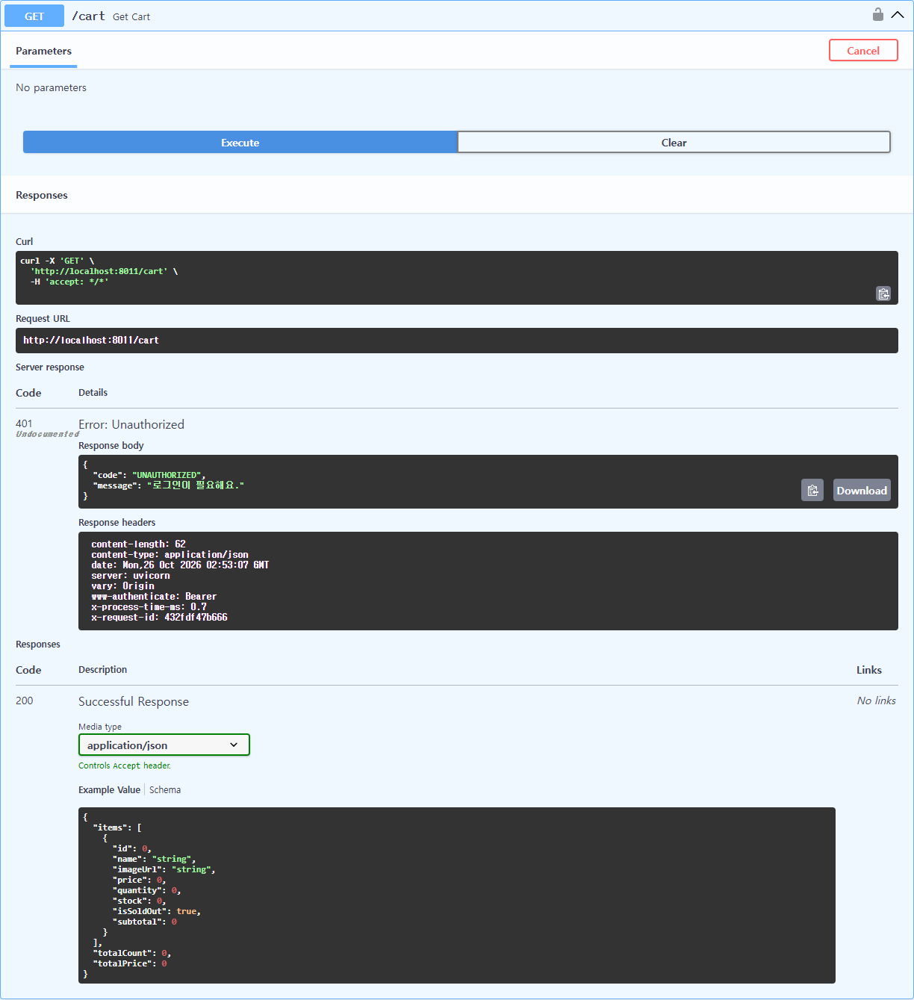

### 422 수량 0
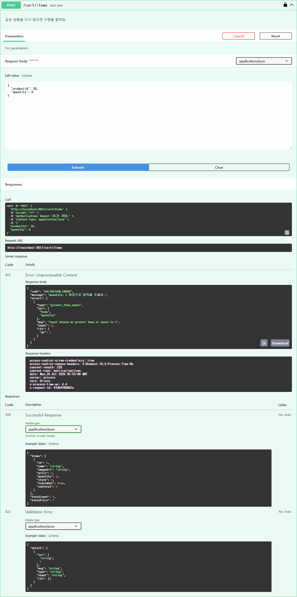

### 404 없는 상품 담기
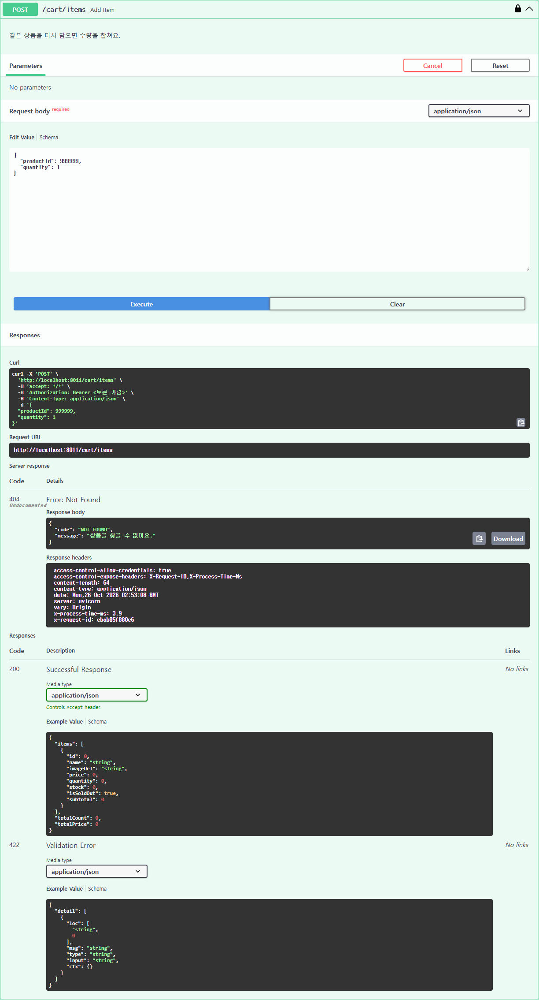

### 409 재고 초과 담기 + DB 재조회
장바구니에 2개 있는 상품(재고 10)에 9개 더 담기 → 합쳐서 11개라 409


```
-- 409 전
 member_id | email                 | product_id | quantity
 2         | customer@gourmand.com | 30         | 2
 product_id | name                       | stock
 30         | 웨이롱 곤약 젤리 90g x 2개 | 10
-- 409 후: 장바구니 2개 그대로
 2         | customer@gourmand.com | 30         | 2
```

### 409 주문하는 사이 재고 부족 → 전체 롤백 + DB 재조회
2개 담아 둔 사이 재고가 1개로 줄었을 때 주문


```
-- 409 전
 cart: customer@gourmand.com | product 30 | quantity 2
 stock: product 30 = 1
 orders: (0개 행)
-- 409 후: 재고 1 · 장바구니 2개 그대로, 주문 · 결제 없음
 cart: customer@gourmand.com | product 30 | quantity 2
 stock: product 30 = 1
 orders: (0개 행)
```

### 422 배송 정보 오류 (휴대폰 `02-123-4567`) + DB 재조회
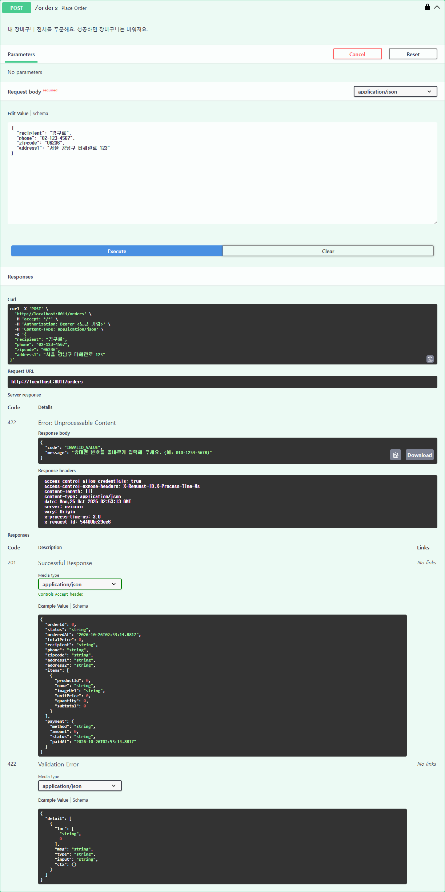

```
-- 422 후: 재고 10 · 장바구니 2개 그대로, 주문 없음
 cart: customer@gourmand.com | product 30 | quantity 2
 stock: product 30 = 10
 orders: (0개 행)
```

### 403 남의 주문 취소 + DB 재조회
김구르가 주문(3번) → 이망고로 `Authorize` 해서 3번 취소

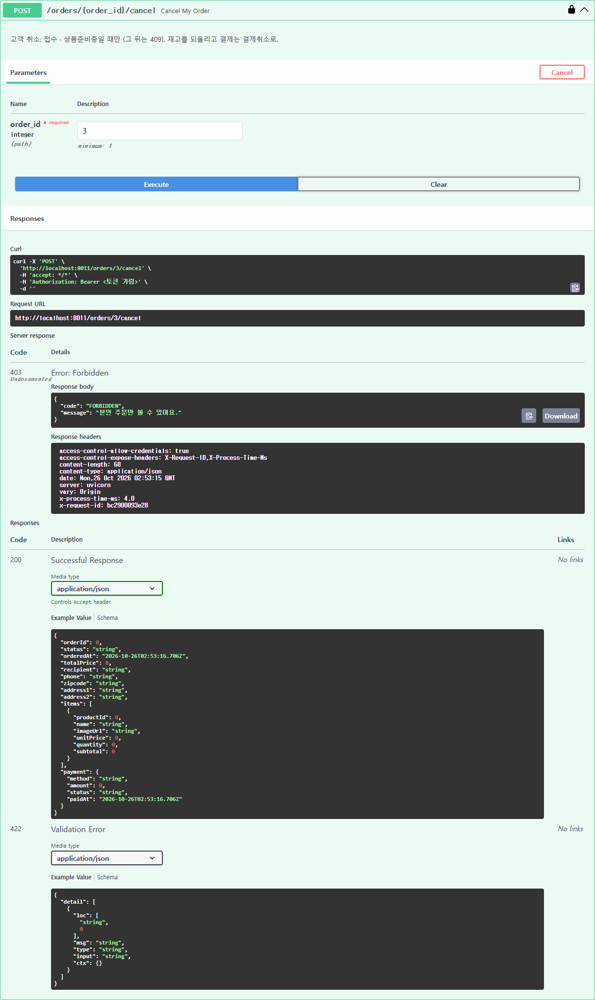

```
-- 주문 3 뒤 (쿠키 2개, 재고 10 → 8)
 order_id | email                 | status | total_price | payment
 3        | customer@gourmand.com | 접수   | 49800       | 결제완료
-- 403 후: 접수 · 결제완료 · 재고 8 그대로
 3        | customer@gourmand.com | 접수   | 49800       | 결제완료
 stock: product 30 = 8
```

### 409 배송중 주문 취소 + DB 재조회
관리자가 출고(배송중)한 3번을 김구르가 취소

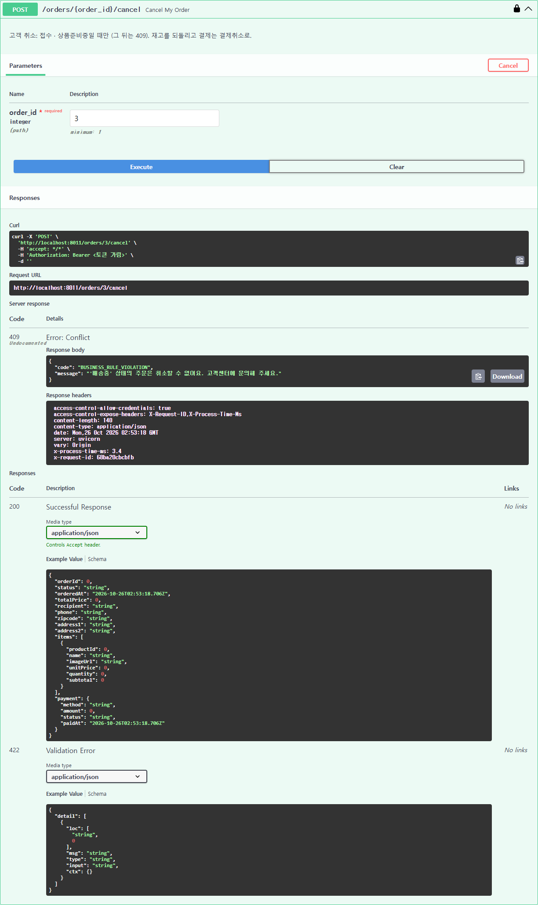

```
-- 409 후: 배송중 · 결제완료 그대로, 재고 복구 없음 (8)
 3        | customer@gourmand.com | 배송중 | 49800       | 결제완료
 stock: product 30 = 8
```

## SCRUM-41 로그인 → 보호 API 성공 → 로그아웃 → 같은 토큰 401

자동 테스트 `test_logged_out_token_is_401_on_every_cart_order_request`: 로그인 → 장바구니 조회 · 담기 · 주문 조회 성공 → `POST /auth/logout` 204 → **같은 토큰으로 장바구니 · 주문 요청 9개 전부 401**, DB 그대로 → 다시 로그인하면 새 토큰으로 장바구니가 그대로 보여요.

### Swagger
`Authorize`(customer@gourmand.com) → 담기 200 → `POST /auth/logout` 204 → 같은 토큰으로 담기 · 주문 401

| 1. 담기 200 | 2. 로그아웃 204 |
|---|---|
| 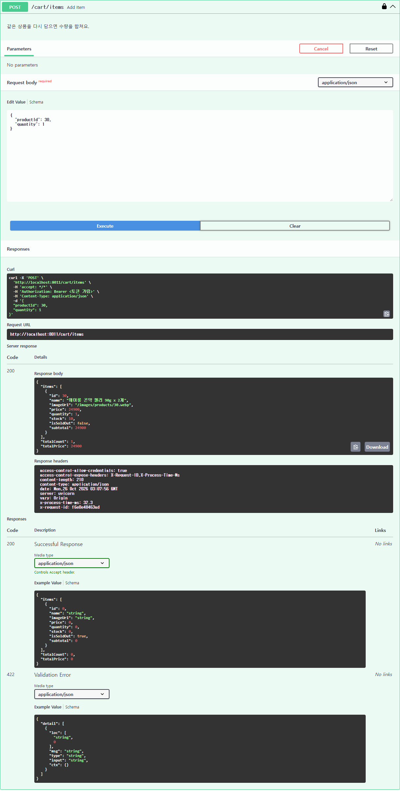 | 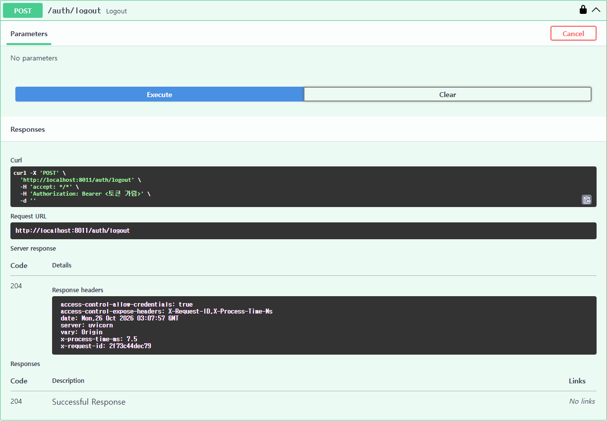 |

| 3. 같은 토큰 담기 401 | 4. 같은 토큰 주문 401 |
|---|---|
| 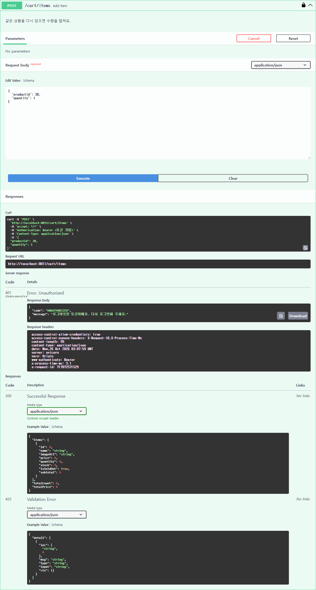 | 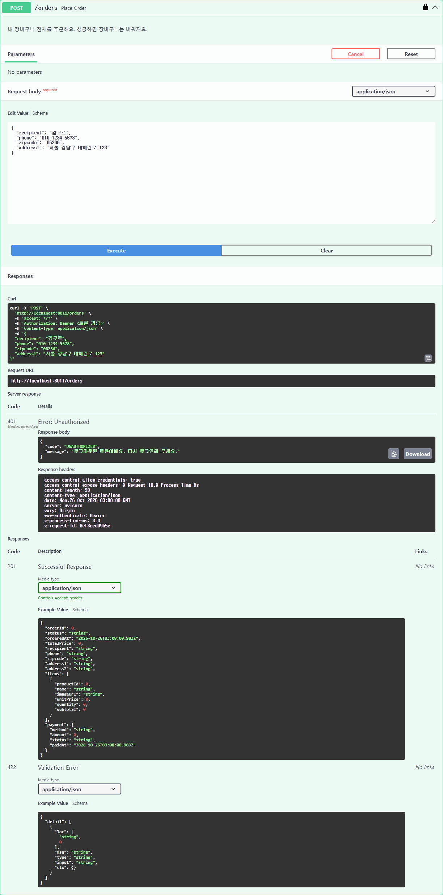 |

```
-- 1. 담기 성공 뒤
 email                 | product_id | quantity
 customer@gourmand.com | 30         | 1
 logged_out_tokens = 0
-- 2. 로그아웃 뒤: 그 토큰이 블랙리스트에
 logged_out_tokens = 1
-- 3. 같은 토큰으로 담기 · 주문 401 뒤: 장바구니 1개 그대로, 주문 0건
 customer@gourmand.com | 30         | 1
 orders = 0
```

### 화면
장바구니를 보던 중 **다른 곳에서 같은 토큰이 로그아웃**됨 → `+` 를 누르면 서버 401 → 저장된 토큰을 지우고 로그인 화면(`?next=/cart`)으로. 다시 로그인하면 장바구니로 돌아와 1개 그대로예요.

| 로그아웃 전 (장바구니 1개) | `+` 누른 뒤 → 로그인 화면 |
|---|---|
| 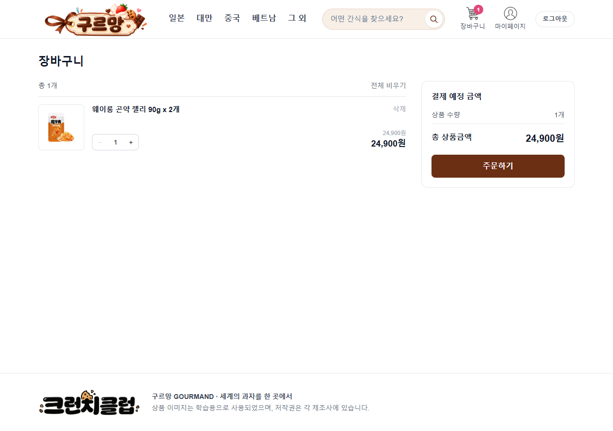 | 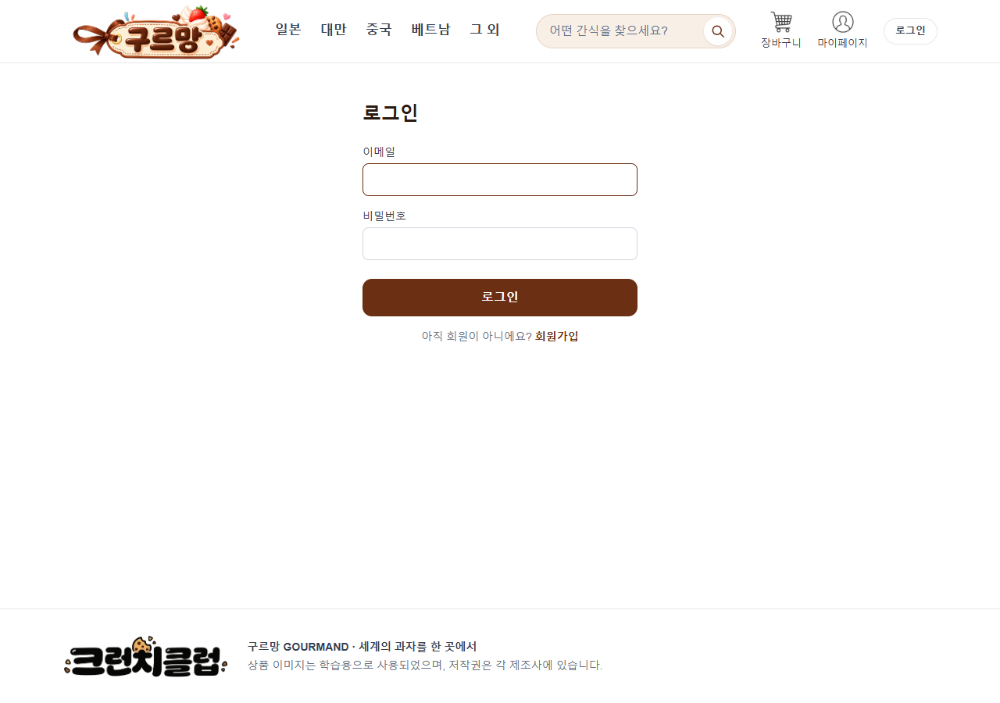 |

```
-- + 시도 뒤: 장바구니 1개 그대로 (2개로 안 바뀜)
 customer@gourmand.com | 30         | 1
 logged_out_tokens = 2   (Swagger 토큰 + 화면 토큰)
```

## 화면

| 상황 | 화면 |
|---|---|
| 401: 로그인하지 않고 담기 → 로그인 화면(`?next=/products/30`), 로그인하면 원래 상품으로 | 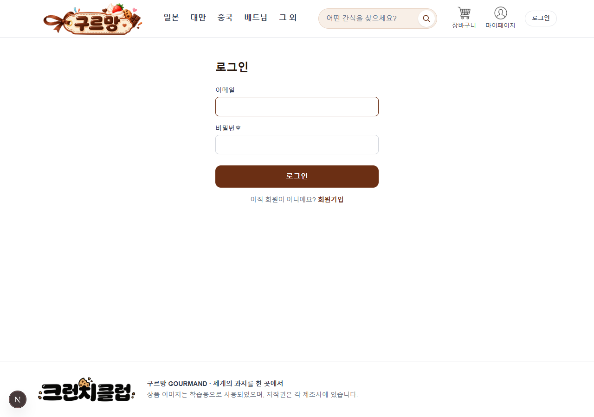 |
| 409: 재고만큼 담은 상품을 카드에서 또 담기 → "더 담을 수 없어요" (자세한 서버 문구는 `title` · 화면 읽기 프로그램) | 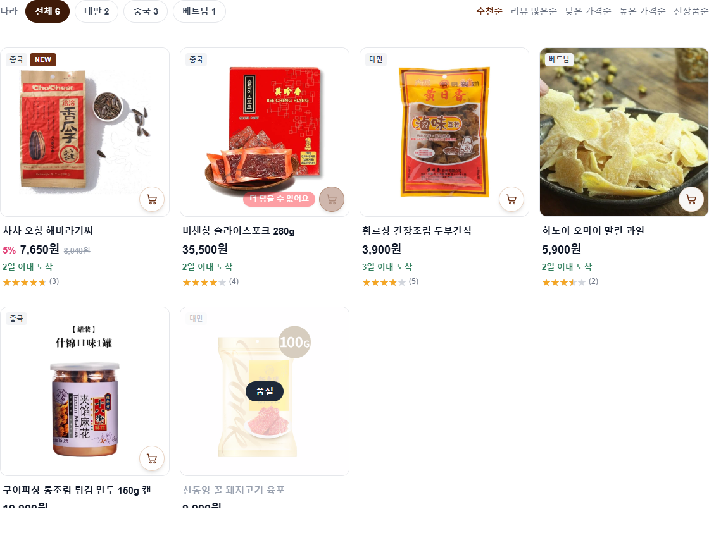 |
| 담아 둔 사이 재고 감소 → "재고가 1개로 줄었어요", 주문하기 잠김 (주문 API 409 를 미리 막음) | 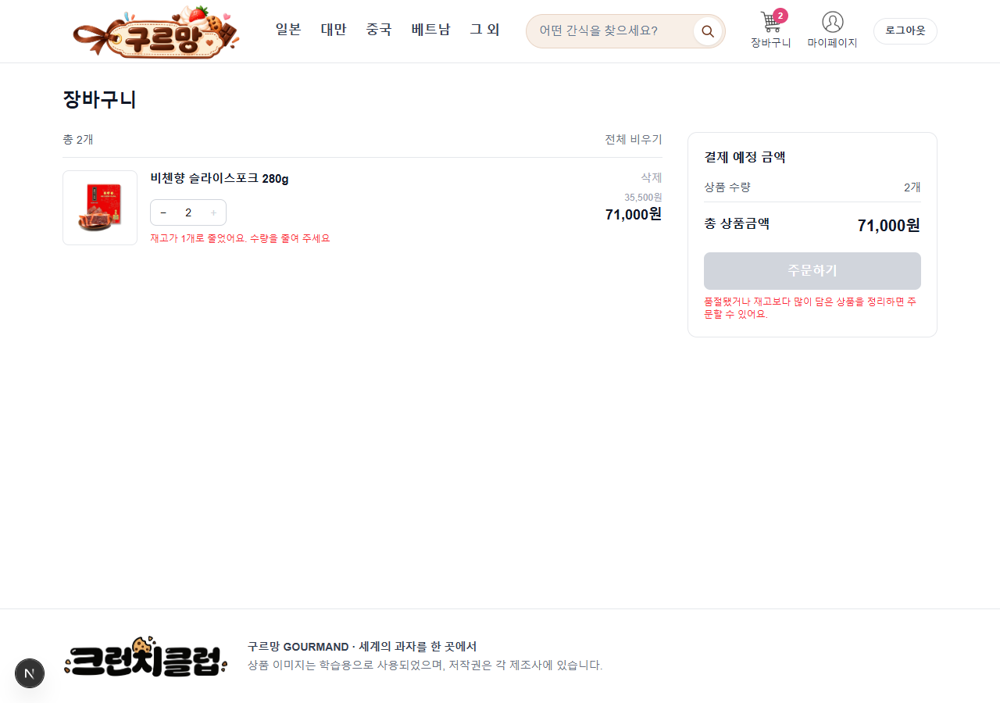 |
| 409: 마이페이지를 연 사이 배송중이 된 주문 취소 → 서버 문구 그대로, 목록 새로고침 | 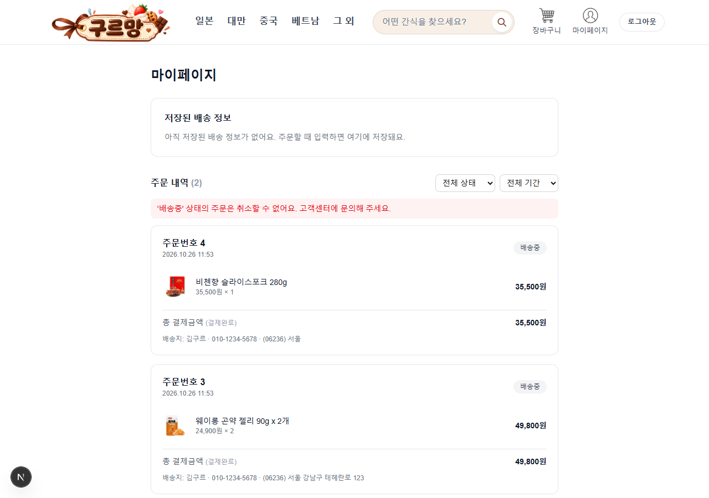 |

화면에서 확인한 DB:

```
-- 재고 감소 안내 시점: 장바구니 2개 > 재고 1
 customer@gourmand.com | product 22 | quantity 2
 stock: product 22 = 1
-- 마이페이지 취소 거절 후 (주문 4): 배송중 · 결제완료 그대로
 order 4 | 배송중 | payment 결제완료
```

배송 정보 422 는 화면이 보내기 전에 같은 규칙으로 먼저 막아서(프론트 `CheckoutForm` 검사), 서버 문구가 입력칸 아래에 나오는 경우는 SCRUM-30 에서 응답을 바꿔치기해 확인했어요.

캡처에 쓴 계정 · 주문은 임시 DB 와 함께 지웠어요.
